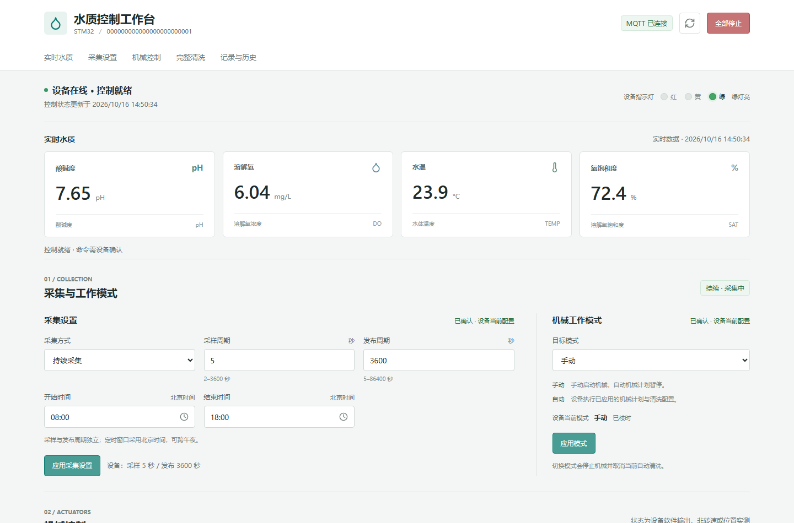
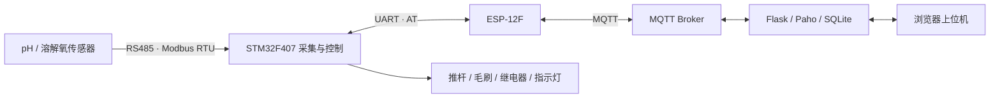

# 罗非鱼养殖水质监测终端

面向养殖现场的水质采集与设备控制系统：以 **STM32F407 + RS485/Modbus RTU + Wi-Fi/MQTT** 为主链路，将 pH、溶解氧、水温、溶氧饱和度送到 Python 可视化上位机，并通过带回执的远程命令管理采集计划、毛刷、推杆和自动清洗流程。

**技术栈：** C / STM32 HAL / Keil MDK / Modbus RTU / MQTT / Python / Flask / SQLite / JavaScript / Playwright

[系统架构](docs/architecture.md) · [硬件与通信协议](docs/hardware-and-protocol.md) · [构建与运行](docs/build-and-run.md) · [验证记录](docs/verification.md) · [第三方说明](THIRD_PARTY_NOTICES.md)

## 项目场景

养殖水质监测既要处理传感器采样与通信，也要协调探头清洗、机械动作和远程操作。本工程将这些任务组织为独立模块：底层负责引脚、串口和报文收发；业务层管理采集时序、状态机和配置持久化；上位机展示测量值、历史记录与设备回执。

仓库包含终端固件、浏览器上位机、八类硬件模块的测试入口，以及覆盖固件与 Python 接口的自动化测试。

## 界面预览



上位机使用协议测试数据生成的界面预览，展示四项测量值、采集配置、清洗控制和命令状态。

## 核心设计

| 方向 | 实现内容 | 主要入口 |
| --- | --- | --- |
| 传感器采集 | Modbus CRC、异常应答、寄存器数量校验、四项测量值的完整性检查 | [water_sensor.c](firmware/Application/Src/water_sensor.c)、[modbus_rtu.c](firmware/Application/Src/modbus_rtu.c) |
| 网络通信 | 串口中断收包、AT 事务边界、MQTT RAW 发布、订阅与连接恢复 | [at_command.c](firmware/Application/Src/at_command.c)、[esp12f_wifi.c](firmware/Application/Src/esp12f_wifi.c) |
| 远程控制 | 严格 JSON 字段校验、命令有效期、重复命令识别、状态分片与回执 | [control_protocol.c](firmware/Application/Src/control_protocol.c)、[remote_control.c](firmware/Application/Src/remote_control.c) |
| 自动清洗 | 推杆伸出、毛刷运行、推杆收回与静置的状态切换；动作超时与换向保护 | [cleaning_controller.c](firmware/Application/Src/cleaning_controller.c)、[actuator.c](firmware/Application/Src/actuator.c) |
| 调度与配置 | 手动/自动模式、跨午夜采集窗口、周期/每日计划、Flash 配置日志 | [control_config.c](firmware/Application/Src/control_config.c)、[config_flash.c](firmware/Application/Src/config_flash.c) |
| 可视化上位机 | 实时水质、历史数据、CSV 导出、控制草稿、在线状态和设备确认 | [app.py](desktop/app.py)、[control_core.py](desktop/control_core.py)、[app.js](desktop/static/app.js) |

## 系统链路



固件默认启用 Wi-Fi 业务链路；网络参数集中在 [network_config.h](firmware/Application/Inc/network_config.h)，硬件映射集中在 [board_config.h](firmware/Application/Inc/board_config.h)。

## 源码目录

```text
.
├── firmware/
│   ├── Application/        采集、联网、控制、清洗、时间和配置模块
│   ├── Core/               CubeMX 生成的启动入口、中断、GPIO、UART
│   ├── Drivers/            ST HAL 与 CMSIS
│   ├── MDK-ARM/            Keil 工程与启动汇编
│   ├── ThirdParty/jsmn/    JSON token 解析器
│   ├── tests/              HAL 桩、协议、状态机与网络恢复测试
│   ├── tools/              工程同步、配置核验与构建脚本
│   └── XIAOLI-CODE.ioc     STM32CubeMX 配置
├── desktop/
│   ├── app.py              本机 HTTP API、页面与 CSV 入口
│   ├── control_core.py     状态组帧、命令生命周期与 SQLite 存储
│   ├── mqtt_service.py     MQTT 收发适配
│   ├── static/             页面、样式、图表与交互
│   └── tests/              业务、回归、固件契约与浏览器测试
├── module-tests/           电源、灯、推杆、毛刷、继电器、Wi-Fi 等测试入口
└── docs/                   架构、协议、运行和验证说明
```

### 建议阅读顺序

1. 从 [application.c](firmware/Application/Src/application.c) 了解初始化与周期任务。
2. 沿 [water_reporter.c](firmware/Application/Src/water_reporter.c) 阅读采集、清洗协调和发布时序。
3. 通过 [remote_control.c](firmware/Application/Src/remote_control.c) 与 [control_core.py](desktop/control_core.py) 对照设备端和上位机端的命令闭环。
4. 查看 [固件测试](firmware/tests) 和 [上位机测试](desktop/tests)，理解异常输入、断线和重复报文的处理方式。

## 快速运行

### 固件主机测试

在 Linux 或 WSL 中，使用带 AddressSanitizer / UndefinedBehaviorSanitizer 的 GCC 运行：

```sh
sh firmware/tests/run_tests.sh
```

### 启动上位机

配置自己的 MQTT 服务，并使设备与上位机的设备 ID 保持一致。详细参数见[运行文档](docs/build-and-run.md)。

```powershell
python -m pip install -r desktop/requirements.txt
$env:WATER_MQTT_HOST = "127.0.0.1"
$env:WATER_MQTT_USER = "YOUR_MQTT_USER"
$env:WATER_MQTT_PASSWORD = "YOUR_MQTT_PASSWORD"
$env:WATER_DEVICE_ID = "YOUR_DEVICE_UID"
python desktop/app.py
```

服务默认监听 `127.0.0.1:5070`，自动打开本机页面；端口被占用时会选择可用端口并输出地址。

## 工程验证

本次发布整理执行了 Keil 全量构建、固件主机测试、Python 业务/回归/固件契约测试及浏览器交互测试。具体命令、环境和结果见[验证记录](docs/verification.md)；GitHub Actions 对后续提交持续运行固件与上位机接口检查。

第三方组件沿用各自许可与版权信息，详见[第三方说明](THIRD_PARTY_NOTICES.md)。
