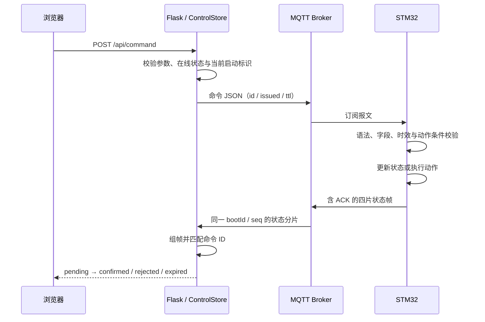

# 系统架构与业务流程

## 分层组织

| 层级 | 职责 | 代码 |
| --- | --- | --- |
| 板级与外设 | GPIO 安全电平、UART 初始化、中断接收、传感器供电 | `Core/`、`board_config.h`、`uart_channel.c` |
| 通信适配 | RS485 收帧、Modbus 请求与校验、Wi-Fi AT 命令、MQTT 收发 | `rs485.c`、`modbus_rtu.c`、`at_command.c`、`mqtt_transport.c` |
| 业务控制 | 采集计划、清洗流程、机械动作、时钟与 Flash 配置 | `water_reporter.c`、`cleaning_controller.c`、`remote_control.c` |
| 应用呈现 | MQTT 接收、状态分片组装、命令确认、历史存储、浏览器交互 | `desktop/` |

## 采集与发布

1. 初始化 GPIO 安全状态、传感器供电、串口通道和网络管理。
2. 按配置处理传感器预热、采样周期和采集窗口。
3. 读取 pH、溶解氧、水温和溶氧饱和度，对应答长度、CRC、从机地址和数值范围进行检查。
4. 四项数据均有效时更新采样结果；发布周期到达后构造水质 JSON。
5. 清洗与执行器动作期间协调采集时序，恢复采集时重新读取传感器。

测量值发布与设备在线心跳采用不同节奏，上位机分别跟踪水质更新时间和实时控制状态，避免把较长发布周期当成设备离线。

## 远程命令闭环

命令使用 QoS 0 且不保留。界面提交成功后进入等待确认状态，由匹配的设备实时回执决定结果。断线、超时、设备重启等情况会结束相应等待，不会自动重放机械动作。

## 清洗与机械保护

自动清洗按伸出、刷洗、收回、静置的顺序推进。毛刷和推杆分别维护动作截止时间；推杆换向经过停止间隔。AT 事务等待期间仍维护机械超时，远程停止可在通信处理过程中进入控制逻辑。

上位机将电气驱动方向映射到机械伸出/收回语义，映射集中在对应前端命令与状态转换代码；首次装配需按实际接线核对方向。

## 状态与持久化

- 固件将配置存入 Flash 日志，记录包含版本、范围与 CRC 校验。
- 应用镜像与配置扇区分别约束，避免重新生成工程后覆盖配置保留区。
- 上位机使用 SQLite 保存测量历史和命令记录。
- `bootId`、序列号和分片编号用于隔离设备重启、乱序与重复状态帧。
- 页面维护用户正在编辑的草稿，周期刷新不会直接覆盖编辑内容。

[返回项目首页](../README.md)
